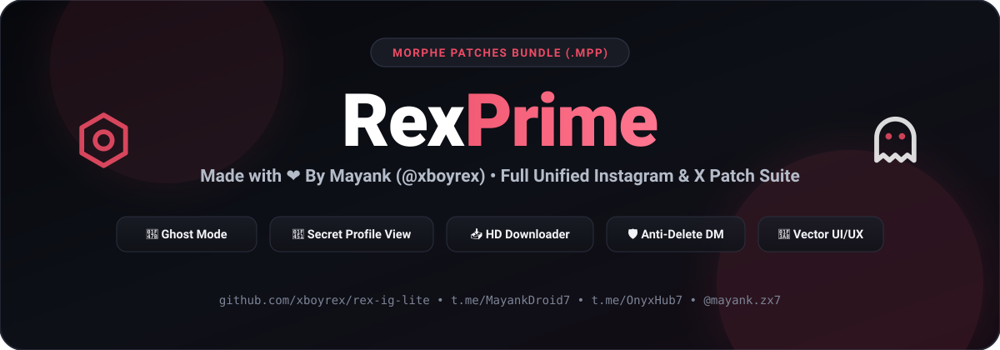

<div align="center">



<br/>

# RexPrime (`rex-ig-lite`)

**The Complete Unified Morphe Patch Suite for Instagram & X (Twitter)**  
*Crafted with ❤️ by **Mayank** ([@xboyrex](https://github.com/xboyrex)) • Zero Bloat • Custom Vector UI/UX • Self-Contained `.mpp` Build*

[](https://github.com/xboyrex/rex-ig-lite/actions/workflows/build.yml)
[](https://github.com/xboyrex/rex-ig-lite/releases)
[](https://www.gnu.org/licenses/gpl-3.0)
[](https://t.me/MayankDroid7)
[](https://t.me/OnyxHub7)

<br/>

<a href="morphe://add-patch-bundle?url=https://github.com/xboyrex/rex-ig-lite/releases/latest/download/bundle.json">
  
</a>

</div>

---

## ✨ Highlights & RexPrime UI/UX Architecture

`rex-ig-lite` merges **100% of the full feature set** into a single, standalone, zero-dependency Morphe repository with the custom **RexPrime** dark UI/UX:

- **Two-Tone `RexPrime` Hero Header**: Clean dark header with white `Rex` + coral-pink `Prime` (`#EB4B64`), `Made with ❤️ By Mayank (@xboyrex)` subtitle, centered screen titles, and top-right instant Translator (`文A`) selector.
- **60+ Custom Android Vector Outline Icons (`RexVectorIcons`)**: Crisp 24×24 anti-aliased vector icons rendered natively on every settings category, toggle row, popup item, and action bar button.
- **Floating Quick Action Menu**: Tap the top-right Hexagon Nut icon (`rex_ic_settings`) on the feed or profile to open the floating Quick Action Menu:
  - *RexPrime Settings*, *Ghost Mode Toggle*, *Long Video Splitter*, *Dark Mode (AMOLED) Toggle*, *Developer Options*, *Restart App*, *DND Mode*, *Watch History*, *Saved Profiles*, and *Deleted Messages (Live Counter)*.
- **12 Organized RexPrime Categories + Info**:
  1. **Premium**: Lifetime RexPrime status, Plus benefits unlock, and quick links to pro tools.
  2. **View Blocked Profiles Secretly 👑**: Anonymously inspect accounts that blocked you.
  3. **Ghost Mode**: Hide Story View, Hide Live View, Hide Screenshot Taken, Hide Typing Status, Hide Message Seen, Mark Chat as Read, Hide Story Replies, Hide Call Buttons, Ghost Instants, Unlimited Replays on Ephemeral Media, and Inbox Lock.
  4. **Notification**: Save Deleted Messages (Realtime Anti-Revoke DB Vault), Deleted Messages Viewer, Clear Saved Messages, and Share/Screenshot/Story Download alerts.
  5. **Privacy**: Disable Ads (Feed, Stories, Reels, Explore), Hide Suggested Content, Open Links Externally, Sanitize Share Links, Custom Sharing Domain, and Disable Analytics.
  6. **Gestures**: Disable Double-Tap Like (Post, Reel, Comment, Message), Swipe Camera Gesture toggle, Reels Tap & Hold 2x Speed, Reels Lock Controls, Story Auto-Pause, Long-Press Fast-Forward, Swipe Navigation, Volume Key Scroll, Triple-Tap Download, Shake to Clear Cache, and Double-Tap Profile Picture to Copy Bio.
  7. **Feed and Stories**: Follow Back Indicator, Colored Follow Indicator, Non-Follower Badge in Lists, Disable Video Autoplay, Disable Story Auto-Flip, Force High Quality Images (4096px), View Story Mentions, Story Timestamp Format, Loop Stories, Story Ring Scale, Force HD Stories, Max Upload Quality, Reel Ring Captions, Sound Button Overlay, and Show Exact Follower Count.
  8. **UI Tweaks**: Pure Black AMOLED & Material You themes, Navigation Bar Reorder/Hide, Action Bar Buttons, Custom Font & System Emoji manager, Like Animation previewer, Extended Post Options, and button visibility toggles.
  9. **Focus Mode**: Focus Lock with countdown timer & enforced distraction locks, Story Content Filters, Disable Stories/Explore/Comments/Highlights/Reels Scrolling/Swipe to Camera.
  10. **Miscellaneous**: Local vaults for *Saved Bios*, *Saved Captions*, *Saved Profiles*, and *Watch History*, plus *Message Translator*, *Voice Message Speed Control*, *Split Video for Stories*, *WhatsApp Share Integration*, and *Screenshot Blocker*.
  11. **Downloads**: In-feed, Reel, Story, and Instant download buttons, Direct Download, Split by Username subfolders, Embed Metadata, Custom Filename Template builder, and External Downloader integration.
  12. **Developer Options**: Protected by a safety warning modal; unlocks MetaConfig, Employee Options, User SSL/TLS Certificates, Recommended Flags, Experiment Decompiler, and ID Mappings.
- **Extended Profile & Post/Reel Menus**:
  - **Profile More Options Popup**: *Download Profile Picture*, *View Profile Picture*, *Copy Bio*, *Save Bio*, *Copy Username*, *Copy Full Name*, *Copy User ID*, *Copy Profile URL*, and *Save Profile*.
  - **Post & Reel 12-Option Sheet**: *Download*, *Copy Caption*, *Translate Caption*, *Save Caption*, *Share Media Link*, *Open in Browser*, *Share to WhatsApp*, *Copy Username*, *Save Profile*, *View Author Profile*, *repost*, and *Download Audio*.

---

## 📱 Supported Target Versions

| App | Package Name | Target Versions |
| :--- | :--- | :--- |
| **Instagram** | `com.instagram.android` | `453.0.0.57.79` (`385914517`), `451.0.0.53.80` (`385704221`), `447.0.0.55.81` (`385311895`) |
| **X (Twitter)** | `com.twitter.android` | `12.19.1-release.0` |

---

## 🚀 Termux One-Copy-Paste Push & Auto-Build (`.mpp`)

Use the included `push_to_github.sh` script in Termux to create the GitHub repository under `xboyrex`, push the entire codebase, and trigger the GitHub Actions `.mpp` build automatically:

```bash
bash push_to_github.sh
```

Once pushed, GitHub Actions will automatically compile `rex-ig-lite-patches-<version>.mpp` and publish it to your repository's **Releases** and **Actions Artifacts** tabs.

---

## 🌐 Connect with Mayank (`@xboyrex`)

- **GitHub**: [@xboyrex](https://github.com/xboyrex)
- **Instagram**: [@mayank.zx7](https://www.instagram.com/mayank.zx7)
- **YouTube**: [@mayankdroid](https://youtube.com/@mayankdroid?si=slX8DDU0dpLSIYyY) • [@onyxdroid89](https://youtube.com/@onyxdroid89?si=9gxpZfa3bpI9PKku)
- **Telegram Channel**: [t.me/MayankDroid7](https://t.me/MayankDroid7)
- **Telegram Discussion Group**: [t.me/OnyxHub7](https://t.me/OnyxHub7)
- **Email**: [xboyrex496@gmail.com](mailto:xboyrex496@gmail.com)

---

## 📄 License

Licensed under the **GNU General Public License v3.0 (GPLv3)**. See [LICENSE](LICENSE) and [NOTICE](NOTICE) for details.
